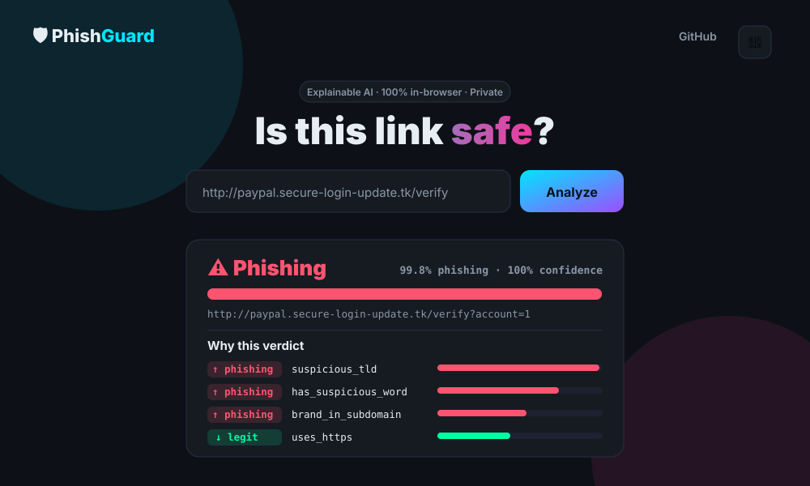

<div align="center">

# 🛡️ PhishGuard

### Explainable, privacy-first phishing-URL detection — CLI + web dashboard

Detect whether a URL is **phishing** or **legitimate**, and understand *why*.
Built from scratch in pure Python (zero dependencies) with a premium, fully
client-side web dashboard. Open source, free for learning & community use.

<p>
  
  
  
  
</p>

<a href="https://aashishbharti04.github.io/phishguard/"><b>🚀 Live demo</b></a> ·
<a href="docs/REPORT.md">📄 Project report</a> ·
<a href="docs/ARCHITECTURE.md">🏛️ Architecture</a>

</div>

---

## 📖 Project overview

Phishing is one of the most common cyber-attacks: a deceptive URL tricks users into
revealing credentials. **PhishGuard** classifies URLs using machine-learning models
implemented from first principles, and — unlike most "black box" detectors — **explains
every decision** by showing the URL features that drove it. Detection uses only the URL
string (no page fetch), so it's fast and privacy-preserving.

It ships two ways to use it:
- a **command-line tool / Python library**, and
- a **web dashboard** that runs the exact same model **entirely in the browser**.

## 📸 Screenshots

<div align="center">
  
  <p><sub>The web dashboard — verdict, probability gauge, and per-feature explanation (dark mode).</sub></p>
</div>

## ✨ Features

- 🧠 **Explainable verdicts** — every result lists the top features that influenced it
- 🔐 **Privacy-first** — 100% client-side; no uploads, no backend, no API keys
- ⚡ **Instant** — analyzes the URL string only (no network lookups)
- 🧪 **From-scratch ML** — Logistic Regression + Gaussian Naive Bayes, no scikit-learn
- 📊 **Reproducible experiments** — 5-fold cross-validation (accuracy/precision/recall/F1/ROC-AUC)
- 🖥️ **Premium dashboard** — dark/light mode, responsive, accessible, loading/empty/error states
- 🧰 **CLI + library** — `phishguard <url>` and an importable Python package
- 🆓 **Zero dependencies** (standard library only)

## 🚀 Installation

```bash
git clone https://github.com/aashishbharti04/phishguard
cd phishguard
pip install -e .          # installs the `phishguard` command (optional)
```
Requires **Python 3.9+**. No third-party packages are needed to run it.

## 🕹️ Usage

**CLI**
```bash
phishguard "http://paypal.secure-login-update.tk/verify"   # classify + explain
phishguard --evaluate                                       # 5-fold CV comparison
python -m phishguard "https://github.com"                   # module form (no install)
```

**Web dashboard (local)**
```bash
python -m http.server 8000 --directory web
# open http://localhost:8000
```

**Library**
```python
from phishguard.dataset import load_xy
from phishguard.models import LogisticRegression
from phishguard.features import vectorize

X, y, _ = load_xy()
model = LogisticRegression().fit(X, y)
print(model.predict_proba([vectorize("http://login-verify.paypal.com.tk/")])[0])
```

## ⚙️ Configuration

PhishGuard needs **no configuration or secrets** to run. Optional knobs are documented
in [`.env.example`](.env.example):

| Variable | Purpose | Default |
|----------|---------|---------|
| `PHISHGUARD_DATA` | Path to a custom `url,label` dataset | bundled `data/urls.csv` |
| `PHISHGUARD_THRESHOLD` | Phishing decision threshold | `0.5` |

To use a **real-world dataset** (recommended for serious evaluation), replace
`data/urls.csv` with a public corpus (PhishTank / Kaggle "Malicious URLs"), then run
`python scripts/export_model.py` to refresh the dashboard model.

## Models

PhishGuard includes machine-learning classifiers implemented from scratch in pure Python.

### Logistic Regression
Binary logistic regression trained using batch gradient descent.

### Gaussian Naive Bayes
Gaussian Naive Bayes classifier using class priors and feature-wise Gaussian likelihoods.

### Linear Support Vector Machine
A binary linear SVM trained using hinge-loss subgradient descent.

The SVM:
- Standardizes input features before training
- Converts binary labels internally from `0/1` to `-1/+1`
- Learns a linear decision boundary
- Provides a `decision_function()` for signed decision scores
- Predicts class `1` when the decision score is greater than or equal to zero

The evaluation pipeline supports both probability-based models using `predict_proba()` and margin-based models such as the SVM using `decision_function()`.

## ☁️ Deployment

The web dashboard auto-deploys to **GitHub Pages** via
[`.github/workflows/pages.yml`](.github/workflows/pages.yml) (Settings → Pages → Source:
GitHub Actions). It's static, so it also works on Netlify/Vercel/Cloudflare/S3.
Full guide: [docs/DEPLOYMENT.md](docs/DEPLOYMENT.md).

## 🗂️ Folder structure

```
phishguard/
├── src/phishguard/      # Python package (core)
│   ├── features.py      # 18 lexical/host URL features
│   ├── models.py        # LogisticRegression + GaussianNB (from scratch)
│   ├── metrics.py       # metrics + k-fold cross-validation
│   ├── explain.py       # per-prediction explanations (XAI)
│   ├── dataset.py       # CSV → feature matrix
│   └── cli.py           # `phishguard` command
├── web/                 # client-side dashboard (HTML/CSS/JS + model.json)
├── scripts/             # make_dataset.py, export_model.py
├── data/urls.csv        # bundled labelled dataset
├── tests/               # unit + end-to-end tests
├── docs/                # report, methodology, architecture, deployment, screenshot
└── .github/             # workflows + issue/PR templates
```

## ❓ FAQ

**Is the bundled accuracy real?** The bundled dataset is realistic *synthetic* data so the
project runs offline; scores are near-perfect by construction. Swap in a public dataset for
real-world numbers (~92–97%). See [docs/REPORT.md](docs/REPORT.md) ("threats to validity").

**Does it upload my URLs?** No. The dashboard analyzes URLs locally in your browser; nothing
is sent anywhere.

**Why no scikit-learn?** Implementing the models from scratch keeps the project
dependency-free and demonstrates the underlying math (it's a research project).

**Can I trust the verdict?** It's an educational/probabilistic aid, **not** a guarantee.
Always verify suspicious links through official channels.

## 🤝 Contributing

Contributions are welcome — see [CONTRIBUTING.md](CONTRIBUTING.md) and our
[Code of Conduct](CODE_OF_CONDUCT.md). For security reports, see [SECURITY.md](SECURITY.md).

## 📄 License

[MIT](LICENSE) © Aashish Bharti — free for educational, learning, and community use.

---

<div align="center">

### 📬 Contact & Connect

**Email:** [aashish@marketdoctorsonline.com](mailto:aashish@marketdoctorsonline.com)

[LinkedIn](https://in.linkedin.com/in/aashana1012) ·
[GitHub](https://github.com/aashishbharti04) ·
[YouTube](https://www.youtube.com/@CodeWithAsur) ·
[Instagram](https://www.instagram.com/asurwave1012)

<sub>© PhishGuard. All rights reserved. · This project is open source and available for
educational, learning, and community contributions.</sub>

</div>
